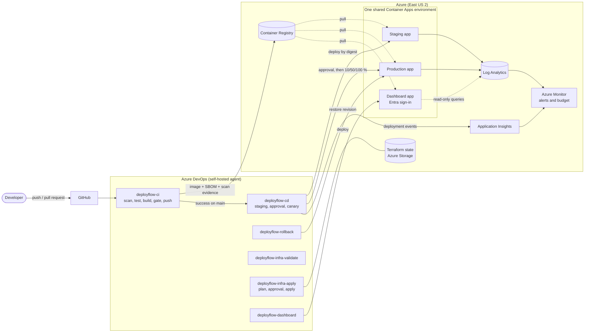
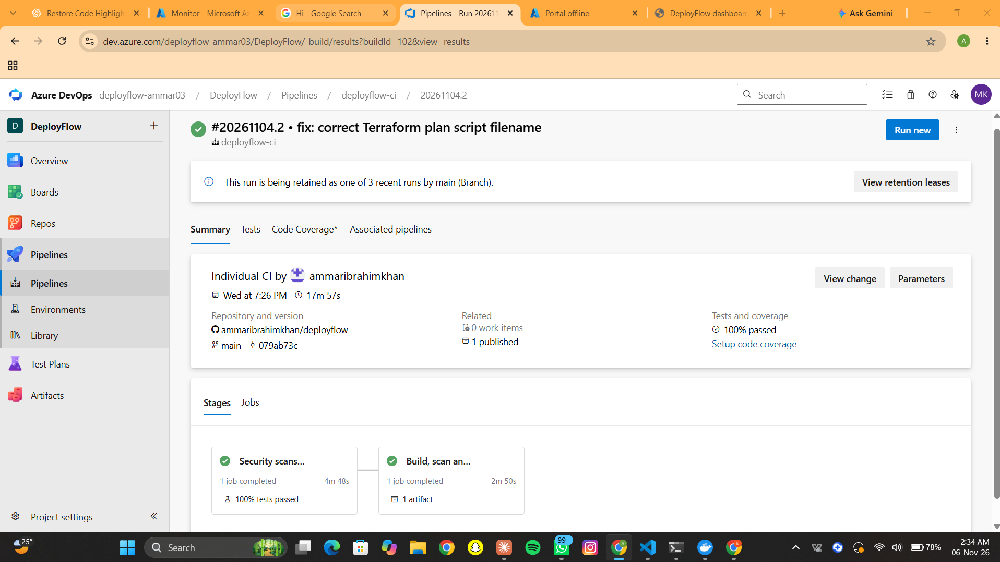
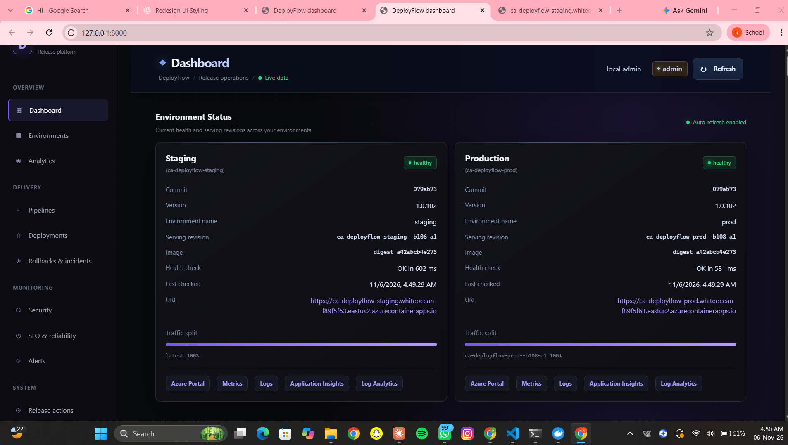
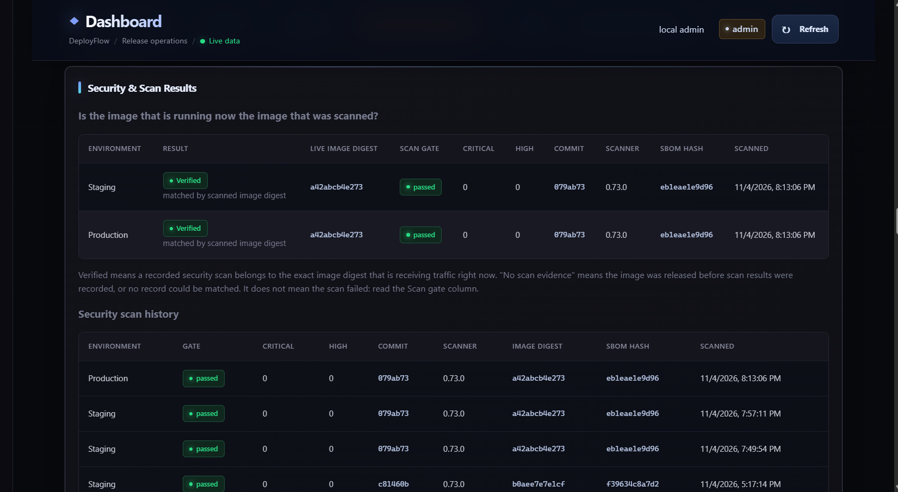
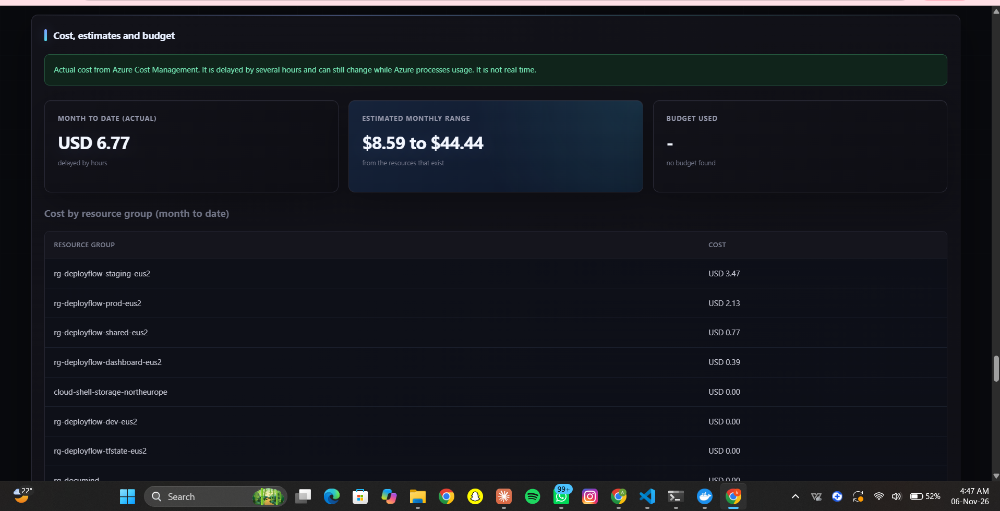

# DeployFlow

An Azure DevOps release platform for a containerised service: secured CI, promotion by image digest, approval-gated production releases with canary traffic and automatic rollback, Terraform-managed infrastructure, observability with SLOs, an Entra-protected release dashboard, and cost and teardown controls.

Built by Ammar as a portfolio project on a free-tier Azure subscription, with one deliberate constraint: **no long-lived credentials anywhere**.

> The Azure DevOps project and the Azure subscription are private. The [screenshots](#screenshots) and the [demo scenarios](docs/demo/demo-scenarios.md) show the platform working.

## What it demonstrates

- **Secured CI**: Trivy (pinned by digest) for source, image and Terraform, Bandit, pip-audit, Ruff, unit tests, a CycloneDX SBOM per build. An image is pushed only if every gate passes.
- **Promotion by digest**: CD never builds. It deploys the exact image digest CI scanned, first to staging, then to production after a human approval.
- **Progressive delivery**: production releases start at 0% traffic, pass a pre-traffic smoke test, then move through 10%, 50% and 100% with error-rate and latency checks. Any breach rolls back automatically.
- **Manual recovery**: an idempotent rollback pipeline, also behind the production approval.
- **Infrastructure as code**: Terraform with remote state, modules, and a controlled apply pipeline (plan, safety checks, approval, apply of the saved plan).
- **Observability**: structured request logs, KQL queries, alert rules, availability test, three SLOs with error budgets, deployment events in Application Insights.
- **Release dashboard**: React and Flask, hosted on Container Apps behind Microsoft Entra sign-in, using a read-only managed identity.
- **Cost and teardown**: actual or clearly labelled estimated cost, a budget, idle detection, and a teardown script that previews first and refuses dangerous deletions.

## Architecture



More detail, including the release sequence and the identities: [docs/architecture.md](docs/architecture.md).

## How a change reaches production

1. A pull request runs the **Test** stage only: Trivy source scan, Ruff, Bandit, pip-audit, pytest.
2. After merge to `main`, **deployflow-ci** also builds the image, smoke tests it, scans it, creates the SBOM and pushes it. Evidence is published as `release-evidence`.
3. **deployflow-cd** starts automatically and deploys the same digest to **staging**, then smoke tests it.
4. **Production** waits for a manual approval and a `main`-only branch check.
5. The pipeline refuses to continue if the digest differs from the one verified in staging.
6. A candidate revision is created at **0%** traffic and smoke tested on its own URL.
7. Traffic moves **10%, 50%, 100%**. After each step the pipeline probes the live URL and the candidate and checks error rate and p95 latency.
8. A breach restores the last known-good revision and records the outcome. Success keeps the previous revision for a fast rollback.
9. A deployment event goes to Application Insights, and the dashboard shows the result and re-verifies the scan evidence for the running digest.

## Pipelines

| Pipeline | File | Purpose |
|---|---|---|
| `deployflow-ci` | `azure-pipelines.yml` | Scan, test, build, gate, push, SBOM |
| `deployflow-cd` | `azure-pipelines-cd.yml` | Staging, approval, progressive production release |
| `deployflow-rollback` | `azure-pipelines-rollback.yml` | Manual, idempotent rollback of production |
| `deployflow-infra-validate` | `azure-pipelines-infra.yml` | Terraform format, Trivy config scan, validate |
| `deployflow-infra-apply` | `azure-pipelines-infra-apply.yml` | Plan, safety checks, approval, apply the saved plan |
| `deployflow-dashboard` | `azure-pipelines-dashboard.yml` | Test, build, smoke test sign-in rules, scan, deploy the dashboard |

## Environments

| Thing | Name |
|---|---|
| Registry | `acrdeployflowsharedammar03` |
| Shared Container Apps environment | `cae-deployflow-shared-eus2` |
| Apps | `ca-deployflow-staging`, `ca-deployflow-prod`, `ca-deployflow-dashboard` |
| Terraform state | Storage account `stdfstateammar03`, one state file per stack |
| Dev environment | Defined in Terraform, removed in Milestone 9 because it was idle |

A free subscription allows only one Container Apps environment, so all apps share it ([ADR 0002](docs/adr/0002-single-container-apps-environment.md)). Isolation comes from separate apps, resource groups, identities and role scopes.

## Security model

- Service connections use workload identity federation: no stored secrets. Apps use user-assigned managed identities with `AcrPull` only.
- Azure credentials exist only in the pipeline steps that push or deploy.
- The scanner is pinned by digest, not by tag ([ADR 0003](docs/adr/0003-security-gates-and-tool-pinning.md)).
- The dashboard requires Microsoft Entra sign-in. Its identity has read-only roles. Actions are off by default and still need the Azure DevOps approval ([ADR 0007](docs/adr/0007-dashboard-design.md), [ADR 0008](docs/adr/0008-hosted-dashboard-and-sign-in.md)).
- Infrastructure changes go through an approval-gated pipeline that blocks deletion of protected resources ([ADR 0009](docs/adr/0009-cost-visibility-and-controlled-infrastructure-changes.md)).
- Identities and permissions: [pipeline identities](docs/security/pipeline-identities.md), [dashboard identity](docs/security/dashboard-identity.md), [infrastructure identity](docs/security/infra-pipeline-identity.md), [security policy](docs/security/security-policy.md).

## Observability and reliability

- Every request writes one JSON log line with status, duration, commit SHA, version and revision, so errors and latency can be traced to a release.
- Alert rules, SLOs and runbooks: [alerts](docs/monitoring/alerts.md), [SLOs](docs/monitoring/slos.md), [failed release runbook](docs/runbooks/investigating-a-failed-release.md).
- A real tuning case is written up as an [incident report](docs/incidents/2026-11-01-noisy-unhealthy-revision-alert.md).

## Dashboard

Panels: environment cards (serving revision, health, traffic split), KPIs, pipeline runs, deployment history, incidents, security verification per image digest, SLOs and error budget, alerts, cost and resources, and role-gated actions. See [ADR 0007](docs/adr/0007-dashboard-design.md).

## Cost and teardown

Actual cost is shown when the subscription allows it, otherwise a labelled estimate range. A monthly budget sends email warnings. See [cost and resources](docs/cost/cost-and-resources.md) and the [teardown runbook](docs/runbooks/teardown.md).

## Measured during development

From the dashboard, 30 days to 2026-11-02. These include deliberate fault-injection drills and early pipeline development, so they are not production statistics.

| Measure | Value |
|---|---|
| Deployments (staging and production) | 14 succeeded, 3 failed (the 3 were canary releases rejected and recovered automatically during drills) |
| Rollbacks | 7 (3 automatic, 4 manual) |
| Pipeline runs | 58 (43 succeeded, 15 failed) |
| Average CI duration | 10 min 30 s |
| Average CD duration | 16 min 46 s (includes waiting for approval) |
| SLOs | Met (traffic is mostly synthetic) |

## Repository layout

```
app/                      Flask sample service, Dockerfile, 8 unit tests
dashboard/                Release dashboard (Flask API, React UI, Dockerfile, 44 unit tests)
infra/
  bootstrap/              One-time Terraform state storage script
  modules/                monitoring, container_app, alerts
  shared/                 Registry, shared environment, platform logs, action group, budget
  envs/                   staging, prod, dashboard (dev removed)
pipelines/                Shared pipeline variables (pinned scanner digest)
scripts/                  Release, rollback, smoke test, Trivy, Terraform plan/apply, teardown, hygiene
monitoring/queries/       Saved KQL queries
docs/                     Architecture, ADRs, runbooks, security, monitoring, cost, demos, incident, portfolio
azure-pipelines*.yml      The six pipelines
```

## Run parts locally

```powershell
# App tests
cd app
py -m venv .venv
.\.venv\Scripts\python.exe -m pip install -r requirements-dev.txt
.\.venv\Scripts\python.exe -m pytest

# Dashboard (uses your own `az login`; a browser tab opens)
cd ..\dashboard
.\run-local.ps1
```

## Building it from scratch (order)

1. `infra/bootstrap/bootstrap-state.ps1` creates the state storage (once).
2. Apply `infra/shared`, then `infra/envs/staging` and `infra/envs/prod`.
3. Create the Azure DevOps service connection, environments (`staging`, `production`, `infrastructure`) and the six pipelines.
4. Apply `infra/envs/dashboard`, turn on Entra sign-in, then let the dashboard pipeline deploy it.

Every step is explained in the ADRs and runbooks.

## Decisions, limits and demos

- [Architecture decision records](docs/adr/README.md)
- [Demo scenarios](docs/demo/demo-scenarios.md)
- [Limitations and roadmap](docs/limitations-and-roadmap.md)

## Screenshots


| What | Image |
|---|---|
| CI pipeline, all gates green |  |
| Dashboard overview |  |
| Security verification by digest |  |
| Cost and resources |  |
