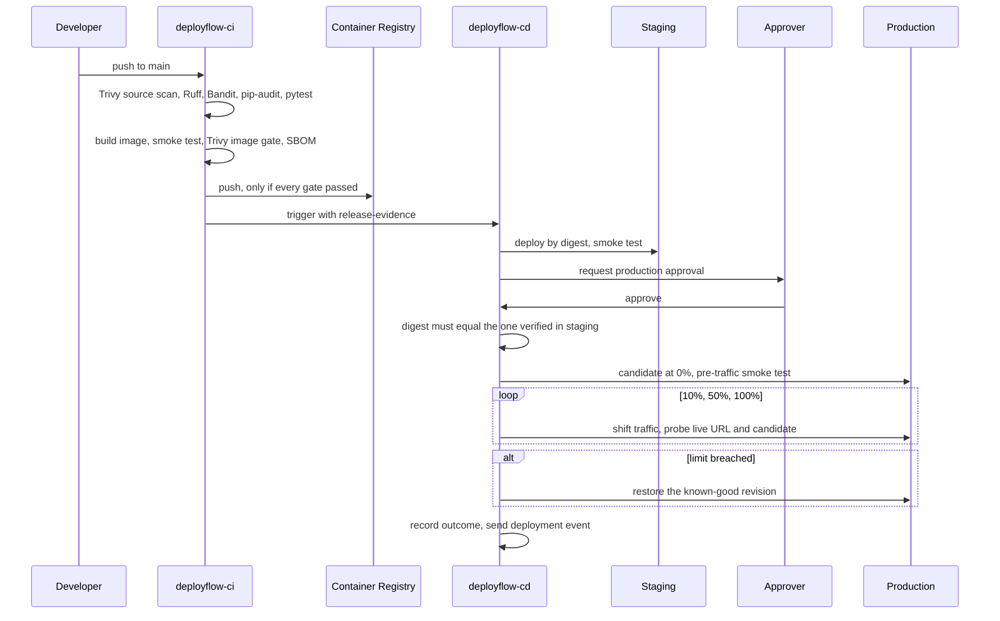

# Architecture

## Release sequence

## Evidence kept for every release

| Artifact | Produced by | Contains |
|---|---|---|
| `release-evidence` | CI | CycloneDX SBOM, Trivy report, security summary, `release-metadata.json` (digest, commit, gate result) |
| `promotion-staging` | CD | Staging record and smoke test result |
| `promotion-production` | CD | Outcome, per-step canary measurements, revisions |
| `rollback-record` | Rollback pipeline | Who, what, when, target revision |
| `infra-plan` | Infrastructure pipeline | The plan that was approved |
| Application Insights event | CD / rollback | Outcome, commit, digest, SBOM hash, scanner version |

## Identities and trust

| Identity | Type | Access | Used for |
|---|---|---|---|
| `sc-azure-deployflow` | Service connection (federated) | Contributor on the shared, staging, production and dashboard resource groups only | Push images, deploy, roll back |
| `sc-azure-terraform` | Service connection (federated) | Contributor and User Access Administrator on the subscription, blob data access to state. Only the infrastructure pipeline may use it, `main` only | Terraform plan and apply |
| App identities | User-assigned managed identity | `AcrPull` on the registry | Pull images |
| Dashboard identity | User-assigned managed identity | Reader, Log Analytics Reader on three workspaces, Cost Management Reader, `AcrPull`; Azure DevOps Readers group | Read-only dashboard data |
| Dashboard users | Microsoft Entra sign-in | Viewer, or administrator if listed | Using the dashboard |

## Resource groups

| Group | Contents | Protection |
|---|---|---|
| `rg-deployflow-tfstate-eus2` | Terraform state storage | Delete lock, versioning, soft delete |
| `rg-deployflow-shared-eus2` | Registry, shared environment, platform logs, action group | Registry has `prevent_destroy` |
| `rg-deployflow-staging-eus2` | Staging app, identity, monitoring, alerts | |
| `rg-deployflow-prod-eus2` | Production app, identity, monitoring, alerts, availability test | `prevent_destroy` |
| `rg-deployflow-dashboard-eus2` | Dashboard app and identity | |

## Why these choices

Each decision has its own record: see the [ADR index](adr/README.md).